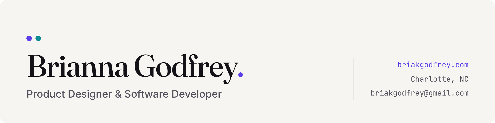

<picture>
  <source media="(prefers-color-scheme: dark)" srcset="./assets/banner-dark.png">
  
</picture>

### Product designer who can build what I design.

**Product-minded. Design-led. Technically fluent.**

I design products that make complicated things feel simple. I start with the people using it, map the flows, and shape clear, accessible interfaces backed by token-based design systems. Then I build them myself in React and TypeScript, so nothing gets lost between the mockup and the code. I write down why I made each choice along the way.

B.S. in Computer Science (Summa Cum Laude, 2026) · Building for clients since 2021 · Charlotte, NC

## 🎨 Selected work

| Project | What it is |
| --- | --- |
| **[PaySupport](https://briakgodfrey.com/work/paysupport.html)** | A support dashboard for diagnosing payment discrepancies, designed and built end to end: React + TypeScript front end on an Express and PostgreSQL API. WCAG 2.2 AA, light and dark themes. [Live demo](https://paysupportdemo.netlify.app/) · [Code](https://github.com/briakgodfrey/paysupport) |
| **[Deepweek](https://briakgodfrey.com/work/weekflow.html)** | A privacy-first planner with day, week, month and calendar views and no login. Shipped and used by 4 people; they opened it to plan more often once I added Month view. [Live app](https://briakgodfrey.github.io/deepweek/) · [Code](https://github.com/briakgodfrey/deepweek) |
| **[AI Buying Concierge](https://briakgodfrey.com/work/concierge.html)** | A B2B "help me choose" flow, taken from buyer interviews, spec and success metrics to a token-based design system and final UI. [Code](https://github.com/briakgodfrey/ai-buying-concierge) |
| **[Strand](https://briakgodfrey.com/work/strand.html)** | A mobile marketplace for small-batch textured hair care, from research to wireframes to a working prototype, built around one question: will this work on hair like mine? [Prototype](https://briakgodfrey.com/strand/) |

**More work:** [benjamingammage.com](https://briakgodfrey.com/work/benjamin.html) (site redesign, tested and handed off with production code) · [Helix & Hue Studio](https://briakgodfrey.com/work/helix-hue.html) (UX concept for a curly and coily hair specialist) · [Charlotte Ironclad FC](https://briakgodfrey.com/work/ironclad-fc.html) (broadcast-inspired sports marketing site)

👉 [Read the case studies](https://briakgodfrey.com) for the problems, process, trade-offs, and what I'd revisit.

## 🔐 Engineering & security

**[paysupport](https://github.com/briakgodfrey/paysupport)** (the API behind the dashboard above)

- Compares internal ledger records against a vendor processor API and flags status mismatches, amount mismatches, and missing records
- Batch reconciliation sweeps plus a cron-ready script that exits non-zero to trigger alerts when drift is found
- Raw SQL with no ORM, JWT auth, Zod validation, an append-only audit log, and a strict Content Security Policy on the dashboard
- Tested with Jest, Supertest, Vitest, Testing Library, MSW, and automated axe checks; Docker Compose and OpenAPI docs

**[inventory-api](https://github.com/briakgodfrey/inventory-api)**: An inventory and order-fulfillment API built with FastAPI and PostgreSQL.

- Role-based access control
- Transactional stock management that prevents overselling under concurrent requests
- Alembic migrations and Docker
- Security documentation mapped to the OWASP API Security Top 10

## 🛠️ Tools I work with

  

## 🌱 Right now

- 🎨 Taking the UX/UI Open design bootcamp
- 🔔 Designing and building Bell, a practice diary app (Svelte PWA)
- 📚 Taking CodePath CYB102
- 🇰🇷 Learning Korean on the side
