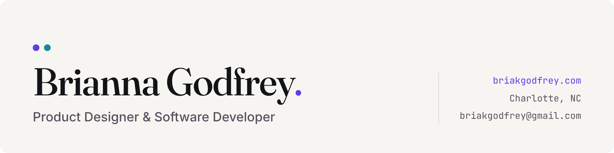

<picture>
  <source media="(prefers-color-scheme: dark)" srcset="./assets/banner-dark.png">
  
</picture>

### Product designer who can build what I design.

I design products that make complicated things feel simple. I start with the people using it, map the flows, and shape clear, accessible interfaces backed by token-based design systems. And when it's time to build, I can do that too: I ship my own designs in React and TypeScript, so nothing gets lost between the mockup and the code. I also design with a security mindset, because I like learning how things break so I can make them hold up.

B.S. in Computer Science (Summa Cum Laude, 2026) · Building for clients since 2021 · Charlotte, NC

## 🛠️ Tools I work with

  

## 🔐 Engineering & Security

**[inventory-api](https://github.com/briakgodfrey/inventory-api)**: An inventory and order-fulfillment API built with FastAPI and PostgreSQL.

- Role-based access control
- Transactional stock management that prevents overselling under concurrent requests
- Alembic migrations and Docker
- Security documentation mapped to the OWASP API Security Top 10

**[paysupport](https://github.com/briakgodfrey/paysupport)**: A full-stack transaction diagnostics and reconciliation tool, with an Express, TypeScript, and PostgreSQL API and a React + TypeScript support dashboard. [Live demo](https://paysupportdemo.netlify.app/sign-in) · [Case study](https://briakgodfrey.com/work/paysupport.html)

- Diagnoses payment discrepancies by comparing internal ledger records against a vendor processor API, flagging status mismatches, amount mismatches, and missing records
- Batch reconciliation sweeps plus a cron-ready script that exits non-zero to trigger alerts when drift is found
- Raw SQL with no ORM, JWT auth, Zod validation, and an append-only audit log
- **Dashboard:** strict TypeScript, React Router, and Zod-validated API responses; session token kept in memory only; a strict Content Security Policy; light and dark themes; WCAG 2.2 AA with automated axe checks
- Tested with Jest, Supertest, Vitest, Testing Library, and MSW; Docker Compose setup and OpenAPI docs

## 🎨 Product Design

I design across web and mobile, from early concepts to shipped products.

| Project | What it is |
| --- | --- |
| **[Deepweek](https://briakgodfrey.github.io/deepweek/)** | A privacy-first planner (formerly Weekflow) with day, week, month and calendar views and no login. Shipped and in active use. Vanilla JavaScript and CSS, with ongoing updates. [Code](https://github.com/briakgodfrey/deepweek) |
| **[AI Buying Concierge](https://briakgodfrey.com/work/concierge.html)** | A B2B "help me choose" flow, taken from spec and success metrics to a token-based design system and final UI. [Code](https://github.com/briakgodfrey/ai-buying-concierge) |
| **[benjamingammage.com](https://benjamingammage.com/)** | Redesigned a streamer's personal site, tested it, and handed off wireframes plus production-ready code. |
| **[Helix & Hue Studio](https://briakgodfrey.github.io/helix-and-hue-studio/)** | A UX case study and website concept for a curly and coily hair specialist, designed around how clients choose a stylist. |
| **[Ironclad FC](https://briakgodfrey.github.io/ironclad-fc/)** | A broadcast-inspired sports marketing site. [Code](https://github.com/briakgodfrey/ironclad-fc) |
| **[Palette](https://briakgodfrey.com/work/palette.html)** | A mobile visual discovery app concept covering onboarding, discovery, saving, and boards. |

👉 [Read the case studies](https://briakgodfrey.com) for the problems, process, design decisions, and what I'd revisit.

## 🌱 Right now

- 📚 Taking CodePath CYB102 and studying for Security+
- 🔑 Next build: a secure secret-sharing API
- 🇰🇷 Learning Korean on the side
